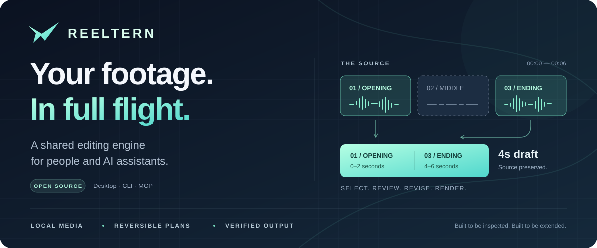

<div align="center">



# Reeltern

### Turn footage into an edit you can understand.

**Local video editing · Reversible decisions · AI through MCP**

[](https://github.com/codesphere-u/reeltern/actions/workflows/tests.yml)
[](CHANGELOG.md)
[](docs/mcp.md)
[](LICENSE)

[**Get started**](#get-started) &nbsp;·&nbsp; [**Connect your AI**](#connect-your-ai) &nbsp;·&nbsp; [**Read the docs**](docs/README.md) &nbsp;·&nbsp; [**Build with us**](#build-with-us)

</div>

---

Reeltern gives people and AI assistants the same editing engine. Select moments from a supplied transcript, arrange source clips, review every decision, and export a video with a verification receipt. Originals stay intact. Earlier edits stay available.

**The idea:** an AI edit should come with source evidence, a reversible plan, and a result you can check.

> [!NOTE]
> **Early preview, actively being built.** The core has 38 automated tests passing on Linux, macOS and Windows. Optional enhancement adapters remain experimental. [See exactly what is tested →](VALIDATION.md)

## An edit is more than an output file

| Start with meaning | Stay in control | Finish with evidence |
| :--- | :--- | :--- |
| **Edit from text.** Import an SRT transcript and select real source passages. | **Keep every revision.** Trim, reorder, change speed, and return to earlier plans. | **Verify the render.** Check dimensions, duration, decoding and source integrity. |
| **Work with your assistant.** Use 21 MCP tools, or an optional local Ollama model. | **Carry captions forward.** Captions follow selected source ranges and playback speed. | **Reuse completed work.** Cache unchanged segments and retry interrupted jobs. |

Desktop, command line and MCP all use the same core. No Reeltern account or API key is required. Your chosen assistant has its own access requirements and data policies.

## The workflow


Every plan records **what was selected, where it came from, how fast it plays, and why it was chosen**. Model explanations remain separate from actual source quotes. A valid plan still needs editorial judgment.

## Get started

**Try a complete edit before bringing your own footage.** Use Python 3.12 for parity with the test environment; the package supports Python 3.10+.

### macOS / Linux

```sh
git clone https://github.com/codesphere-u/reeltern.git
cd reeltern
python3 -m venv .venv
source .venv/bin/activate
python -m pip install -e '.[mcp]'

# Generate footage, make a captioned edit, and verify the result.
reeltern demo --workspace demo-project
```

<details>
<summary><strong>Windows / PowerShell</strong></summary>

```powershell
git clone https://github.com/codesphere-u/reeltern.git
cd reeltern
py -3.12 -m venv .venv
.\.venv\Scripts\python.exe -m pip install -e ".[mcp]"
.\.venv\Scripts\python.exe -m reeltern.cli demo --workspace demo-project
```

Use `.\.venv\Scripts\python.exe -m reeltern.cli` in place of `reeltern` for the commands below. Activation is optional.

</details>

**What the demo produces:** six seconds of synthetic source footage become a four-second preview. The middle section is omitted, captions are retimed, and a second render demonstrates segment reuse. Open the video path printed by the command. No account, user footage, or model download is needed.

FFmpeg is supplied by `imageio-ffmpeg` on supported platforms; an installed system FFmpeg is preferred. Desktop mode additionally needs Tkinter. [Installation help →](docs/troubleshooting.md)

## Choose your way to edit

### In the desktop

```sh
reeltern gui
```

**Import → assemble or suggest cuts → review → preview → export.**

Select **Transcript & AI** to import an SRT and keep selected passages. Revise source ranges or speed in the timeline table, then use **Undo to parent** or **Earlier plans** to revisit decisions. Playback opens in your default video player.

### From the command line

```sh
# Propose conservative cuts around audible activity.
reeltern edit footage.mp4 --workspace my-project

# Create and render a portrait preview.
reeltern edit footage.mp4 --workspace my-project --preset portrait --preview
```

Quiet audio is a signal, not a judgment about meaning. Review the proposed cuts before relying on them for your final edit.

### From a supplied transcript

```sh
reeltern transcript interview.mp4 interview.srt --workspace my-project

# Optional: ask an already-installed local Ollama model for a draft.
reeltern agent TRANSCRIPT_ID "Keep the explanation and conclusion, preserving qualifications" \
  --workspace my-project --model YOUR_INSTALLED_MODEL --seconds 45
```

Use the transcript ID printed by the first command. An MCP assistant can select transcript cues directly without Ollama. Reeltern does not yet transcribe speech. [Transcript workflow →](docs/editorial-agent.md)

## Connect your AI

**Claude Code · Codex · Cursor · VS Code · other local MCP clients**

Generate configuration from the Python environment where Reeltern is installed:

```sh
reeltern mcp-config claude-code \
  --workspace editing-project \
  --media-root demo-project/demo-input
```

Replace `claude-code` with `codex`, `cursor`, `vscode` or `generic`. The command prints settings with absolute paths; merge the Reeltern entry into your client's configuration. It does not change settings automatically. Use an existing footage folder as `--media-root`.

Then ask your connected assistant:

> Import synthetic-source.mp4. Keep source seconds 0–2 and 4–6, in that order. Create a portrait preview, preserve the whole image, wait for completion, and show me the verified result.

| Connection | Editing workflow | Tool contracts |
| :--- | :--- | :--- |
| [Client setup & configuration](docs/clients.md) | [Agent operating guide](docs/agent-workflow.md) | [21-tool reference](docs/mcp.md) |
| [Ready-to-adapt templates](examples/clients/) | [Executable MCP example](examples/mcp_edit.py) | [Machine-readable schemas](docs/mcp-tools.json) |

The server uses local **stdio**, with imports restricted to the configured media root. Give simultaneous clients separate workspaces. Cloud assistants may receive transcript text, prompts and tool results under their own policies; local rendering does not make every assistant interaction private.

## Built for inspectable automation

<details>
<summary><strong>Explore the engineering behind an edit</strong></summary>

| Mechanism | What it provides |
| :--- | :--- |
| **Content-addressed source snapshots** | Imported media is copied; source hashes are checked during analysis and rendering. |
| **Immutable cut plans** | Source ranges, clip order, speed and output timing are saved with revision links. |
| **Bounded local agent** | Selects existing transcript cue IDs, checks the duration budget, and allows at most one repair attempt. |
| **Typed MCP inputs** | Assistants discover tool contracts; nested clip/cue schemas reject unknown fields. |
| **Segment cache** | Unchanged encoded segments are reused after checksum validation. |
| **Persistent render jobs** | Progress, cancellation, errors, interrupted state and retry remain inspectable. |
| **Verification receipts** | Completed output passes dimension/duration checks, full video/audio decoding and source-integrity checks. |

One engine serves all interfaces. No arbitrary shell command, HTML execution or public network endpoint is exposed through MCP. Technical verification does not establish aesthetic quality or perfect perceptual sync.

[Architecture](docs/architecture.md) · [Implementation guide](docs/implementation.md) · [Security](SECURITY.md)

</details>

## An ecosystem worth building on

Reeltern brings a shared workflow around established open-source media tools. **FFmpeg powers the tested core.** The optional toolkit preserves experimental adapters for the wider ecosystem:

| Workflow | Upstream projects |
| :--- | :--- |
| Find and shape moments | PySceneDetect · Auto-Editor · librosa |
| Refine the image | vid.stab · color-matcher · rembg |
| Interpolate and enhance | RIFE · Real-ESRGAN |
| Separate sound and create graphics | Demucs · HyperFrames |
| Process and export | FFmpeg |

Launch it with `reeltern toolkit`. These adapters need separate dependency/model setup and acceptance testing; they are not exposed through MCP. You can import a completed adapter output into the editor.

[Upstream credits & source review](SOURCES.md) · [Adapter setup & limitations](docs/legacy-toolkit.md)

## Build with us

**Help make the first useful edit easier—and the next one better.** There is room for media engineers, Python developers, AI evaluators, designers and people who edit video every day.

| If you care about… | A useful contribution |
| :--- | :--- |
| **Editing by meaning** | Optional transcription, word alignment, and evaluations that catch lost context. |
| **A better editing experience** | In-app preview, waveform selection, keyboard access and clearer review flows. |
| **Reliable exports** | Real-footage tests for phone rotation, variable frame rates, audio offsets and subtitles. |
| **A smoother first run** | Installers, dependency diagnostics, reproducible examples and clearer documentation. |
| **Advanced media workflows** | Promote an optional adapter through a tested, cancellable, documented integration. |

These are contribution opportunities, not released features. The [roadmap](docs/roadmap.md) gives priorities and acceptance criteria.

```sh
python -m unittest discover -s tests -v
python scripts/check_docs.py
```

The suite generates its own media and exercises the real encoder, decoder and MCP transport. Documentation checks validate local links and configuration examples; protocol tests compare the published tool schemas with the running server.

[**Contributor guide**](CONTRIBUTING.md) · [**Implementation guide**](docs/implementation.md) · [**Report a bug**](https://github.com/codesphere-u/reeltern/issues/new?template=bug_report.yml) · [**Propose a feature**](https://github.com/codesphere-u/reeltern/issues/new?template=feature_request.yml)

Coding with an assistant? Start with [AGENTS.md](AGENTS.md), [CLAUDE.md](CLAUDE.md) and the [compact documentation index](llms.txt).

## Know the current limits

> [!IMPORTANT]
> This is an early local editor, not a finished multitrack suite. There is no built-in speech recognition, face tracking, burned-in caption mode, one-click installer or hosted service. The desktop currently uses a timeline table and external playback.

<details>
<summary><strong>Formats, captions, resource limits and recovery</strong></summary>

- **Output:** SDR, 30 fps, H.264/AAC MP4. Landscape 1280×720, portrait 720×1280, square 720×720; previews halve both dimensions. `contain` pads; `cover` center-crops.
- **Streams:** only the first source video/audio streams are used. Original HDR, metadata, subtitle tracks, chapters and multitrack audio are not preserved.
- **Captions:** supplied transcripts produce SRT sidecars and selectable MP4 subtitles. Enable them in your player. Mid-cue trims retain the full cue text because word alignment is not implemented.
- **Speed:** 0.5×–2× uses ordinary frame-rate conversion and audio tempo adjustment; it does not invoke RIFE interpolation.
- **Resources:** input limit 8 GiB/file, timeline limit 200 clips/four hours, queue limit eight unfinished renders. Snapshots and caches consume disk space; automatic eviction is not implemented.
- **Recovery:** the next renderer marks unfinished jobs interrupted. Explicit retry creates a new job and can reuse verified segments; there is no automatic restart or mid-encoder resume.
- **Cancellation:** render jobs are cancellable; import/analysis cancellation is not implemented. A client timeout does not prove background work stopped.
- **Trust:** workspaces are trusted local state. Models can still make poor editorial choices. Core tests use small synthetic fixtures; broad real-footage and every-client UI acceptance remain open work.

[Validation record](VALIDATION.md) · [Troubleshooting](docs/troubleshooting.md) · [Full documentation](docs/README.md)

</details>

---

<div align="center">

**Your footage. Your decisions. A workflow you can build on.**

[GPL-3.0-or-later](LICENSE) · Built on open-source media software · No bundled model weights

<sub>Third-party engines and model weights retain their own licenses. See <a href="SOURCES.md">upstream credits</a>.</sub>

</div>
