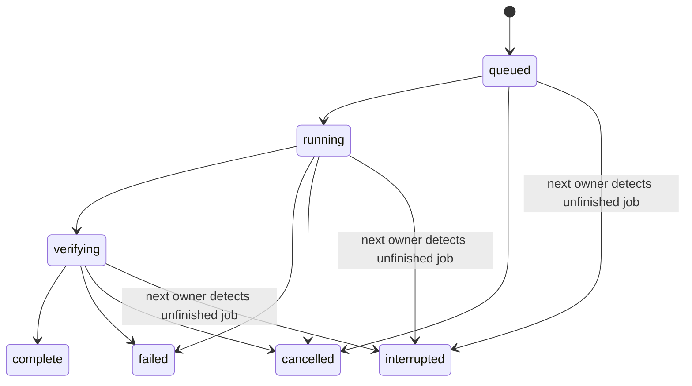

# Implementation guide

This guide is for contributors building features on Reeltern 0.3.1. Use [client setup](clients.md) to connect an assistant, [the operating workflow](agent-workflow.md) to edit footage, and [architecture](architecture.md) for storage and timing details.

## Development environment

Use Python 3.12 for parity with CI; the package declares Python 3.10+. From the repository root:

```sh
python3 -m venv .venv
source .venv/bin/activate
python -m pip install -e '.[mcp]'
python -m unittest discover -s tests -v
python scripts/check_docs.py
python -m reeltern.cli demo --workspace demo-project
```

The desktop additionally needs Tkinter. Tests use synthetic media and the FFmpeg fallback, not downloaded model weights or an AI account. Run `python -m pip wheel . --no-deps --wheel-dir dist` to build a distributable wheel. This project is not currently published to PyPI; install from a clone or a provided wheel.

## Code map

| File | Responsibility | Change here when |
|---|---|---|
| `reeltern/workspace.py` | Imports, IDs, immutable plans, silence analysis, revision comparisons | Adding validated plan data or analysis results |
| `reeltern/transcript.py` | Supplied SRT/cues, transcript integrity, selection, caption retiming | Adding text/timing operations |
| `reeltern/agent.py` | Optional Ollama request, bounded selection validation, one repair, decision report | Changing editorial planning; never execute model output |
| `reeltern/render.py` | Job queue, normalized segments, cache, final mux, receipt | Changing output pixels/audio or job behavior |
| `reeltern/media.py` | FFmpeg selection, subprocess limits, probing, hashes, atomic JSON | Adding low-level media/process operations |
| `reeltern/locking.py` | Cross-platform renderer ownership | Changing recovery/concurrency |
| `reeltern/mcp_server.py` | Typed protocol wrappers, discovery, resources and prompts | Exposing a core operation to assistants |
| `reeltern/client_config.py` | JSON/TOML client launch configuration | Supporting a client's configuration format |
| `reeltern/cli.py`, `studio.py` | Human interfaces over the same core | Adding a command or desktop control |
| `reeltern/engine.py`, `gui.py` | Legacy optional adapters | Experimental upstream integration work |

## Calling the core directly

```python
from reeltern.workspace import Workspace
from reeltern.render import Renderer

ws = Workspace("project", media_root="footage")
asset = ws.import_media("interview.mp4")
plan = ws.create_plan(
    [{"asset_id": asset["id"], "start": 0, "end": 2,
      "reason": "User-selected introduction"}],
    preset="landscape", fit="contain",
)
renderer = Renderer(ws)
try:
    job = renderer.submit(plan["id"], preview=True)
    result = renderer.wait(job["id"], timeout=120)
    if result["status"] != "complete":
        raise RuntimeError(result.get("error", result["status"]))
    print(result["output"])
finally:
    renderer.close()
```

The source must be at least two seconds long. `Workspace` may create working directories; it copies imported bytes. Only the configured media root is accepted when one is provided. `Renderer` owns its workspace until closed, and `close()` cancels unfinished renders and waits for cleanup. The Python API is early-stage: pin the version/commit when embedding it. Do not edit saved plan JSON to add fields.

## Add a feature in six steps

1. **Define observable behavior.** Write an issue with input, intended output, limits and evidence needed to show it works. Say whether it belongs in the tested core or optional toolkit.
2. **Implement core validation.** Validate ranges, finite numbers, paths, list limits and supported options before launching work. All front ends should use the same implementation.
3. **Preserve data contracts.** A plan's ID hashes its normalized content. Changing normalization or saved schemas requires compatibility fixtures or a documented migration. Never silently rewrite old plans. Additions that affect pixels/audio must change the segment key or renderer version so old cached output cannot masquerade as new behavior.
4. **Expose a narrow interface.** Add typed MCP arguments and a useful docstring; distinguish source time from output time. Read-only annotations must reflect side effects. Run long operations away from the event loop. Do not return full transcripts when metadata or a page is enough.
5. **Test observable results.** For rendering, decode output and verify timing, audio, geometry, captions, cancellation and source preservation as applicable. For agents, inject invalid responses and test bounds separately from actual model-quality evaluations.
6. **Document and package.** Update capabilities, MCP reference, examples, changelog and known limits. Regenerate `docs/mcp-tools.json` with `python scripts/export_mcp_reference.py`. Run the relevant tests and full suite before publishing; build a wheel after code changes.

## Reference contracts

- Asset/plan/transcript IDs: SHA-256 strings, 64 lowercase hex characters. Job and agent-run IDs are separate identifiers. Never mix them.
- Plans: 1–200 clips; source seconds; speed 0.5–2×; whole output frames at 30 fps; four-hour timeline limit.
- Presets: landscape 1280×720, portrait 720×1280, square 720×720. Preview halves both dimensions. `contain` pads; `cover` crops the center.
- Transcript cues: chronological, non-overlapping, positive duration, within source; maximum 10,000 cues. One attached transcript per source.
- Agent: one transcript window; at most 200 cues / 40,000 text characters; 1–600-second budget; up to 30 selected unique cues; at most two model calls. A validated draft is not a statement that context is preserved.
- Queue: at most eight unfinished jobs, one render worker, one renderer per workspace. Complete means the output passed the implemented technical checks.
- MCP: stdio only, structured tool errors, no arbitrary command/filter/URL execution, no remote output delivery. Public tool inputs are listed in the generated schema.

## Job lifecycle



Retry creates a new job and leaves the old outcome available. A process can be killed before cleanup; the OS releases the workspace lock and the next renderer marks persisted unfinished jobs interrupted. This is not automatic background resumption or a distributed task service.

## Optional engine integration

The eleven upstream integrations live in the legacy toolkit and are experimental. Do not expose arbitrary legacy recipes as an MCP escape hatch. Before promoting an adapter, establish supported versions/hardware, explicit weight installation, license notices, a small real-media test, resource limits, cancellation, deterministic input/output handoff and meaningful failure messages. For frame operations, evaluate temporal consistency, scene boundaries, FPS and audio synchronization—not just one attractive frame.

## Release checklist

- Run the test suite on the supported CI matrix and record actual results.
- Regenerate schemas; run the executable MCP example and a packaged demo.
- Check source archive/wheel contents for workspaces, private media, credentials and build caches.
- Check setup snippets against current vendor docs; distinguish protocol tests from actual client acceptance.
- Record known gaps in `VALIDATION.md`; do not call adapters tested without evidence.
- Update version, capabilities and changelog together. Retain upstream attribution and GPL notices.

See the [roadmap](roadmap.md) for feature priorities and acceptance criteria.
